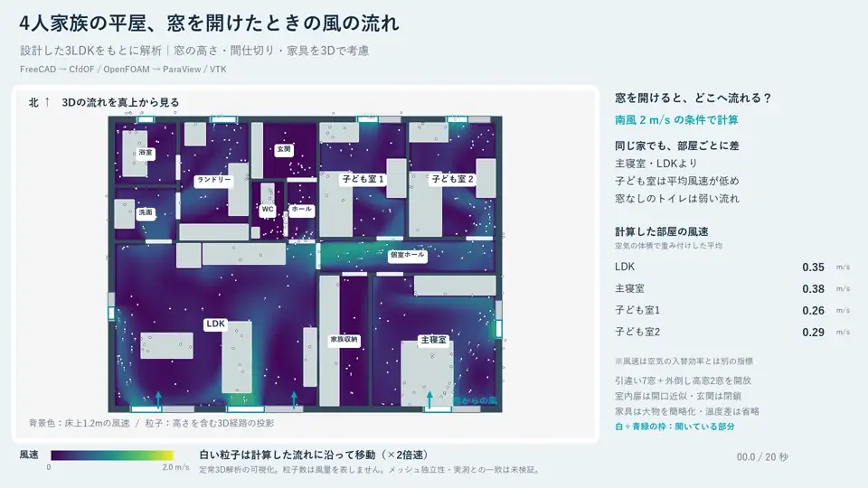

<div align="center">
  
  <h1>FreeCAD CFD Lab</h1>
  <p>家の設計から、OpenFOAMの風通し解析と流線アニメーションまで。</p>
  <p>FreeCAD · CfdOF · OpenFOAM · ParaView / VTK · FFmpeg</p>
  <p><a href="README.md">English</a> | <a href="README.ja.md">日本語</a></p>
</div>

2026年10〜11月にWindowsで行った、OSSによるCAD・CFD連携の実験集です。
公式サンプルの動作確認から、窓配置の比較、家具入り平屋の設計、その家の3D風通し解析までを収録。
編集可能なモデル、実験コード、入力条件、集計結果、検証記録と動画を公開しています。



## 🧪 収録した実験

| 実験 | 調べたこと | 保存結果 |
| --- | --- | --- |
| [エルボ管](experiments/elbow) | CfdOF公式サンプルをOSS構成で実行できるか | 10,823セル・最終242反復 |
| [窓配置の比較](experiments/window-comparison) | 向かい合う窓と隣り合う窓で流れがどう変わるか | 2D定常解析2案・12秒動画 |
| [4人家族の平屋設計](experiments/family-house) | 家具と生活動線を含む3LDKをFreeCADで作れるか | BIMモデル・設計JSON・図面・7ページPDF |
| [平屋の3D風通し解析](experiments/family-house-airflow) | 窓を開けた家のどこへ風が届くか | 538,479セル・最終697反復・20秒動画 |

[実験の条件・数値・検証記録](docs/experiments.md)

## 👀 まず結果を見る

1. 上のアニメーションと各実験の画像・検証JSONを見る。
2. `.FCStd` をダウンロードし、FreeCADでモデルを開く。
3. 解析の最終場が必要なら、[データRelease](https://github.com/Sunwood-ai-labs/freecad-cfd-lab/releases/tag/experiment-data-v1)から取得する。
   ZIPはリポジトリ直下へ展開すると `experiments/` の下に配置されます。大きなメッシュと計算場はGitに含めていません。

```powershell
git clone https://github.com/Sunwood-ai-labs/freecad-cfd-lab.git
Set-Location freecad-cfd-lab
gh release download experiment-data-v1 --repo Sunwood-ai-labs/freecad-cfd-lab --pattern '*.zip' --pattern 'SHA256SUMS.txt' --dir downloads
```

`downloads/SHA256SUMS.txt` と照合してから、必要なZIPを展開します。[詳しい手順](docs/reproduction.md)

## 🌬️ 平屋で分かったこと

南から2m/sの風、9窓を開放、室内ドア全開・玄関閉鎖の条件で、空気体積で重み付けした平均風速は次の値でした。

| 部屋 | 平均風速 |
| --- | --- |
| LDK | 0.353 m/s |
| 主寝室 | 0.384 m/s |
| 子ども室1 | 0.262 m/s |
| 子ども室2 | 0.290 m/s |
| トイレ | 0.037 m/s |

保存記録で、格子品質、形状確認69/69点、場の有限性、流量収支、反復による安定性を確認しています。
585→697反復での主要4室の平均風速変化は最大0.184%でした。
粒子は最終の定常速度場に沿う表示で、窓を開けた直後からの時間変化を解いた動画ではありません。

## 🔁 再現と検証

- [環境と使用バージョン](docs/environment.md)
- [データ取得・表示・再描画・再計算](docs/reproduction.md)
- [条件・根拠・未検証事項](docs/experiments.md)
- [公開時のQA項目](docs/qa-inventory.md)

元の実験の実行結果を保存・検証しています。公開用に調整したコードの全通し実行、コンテナのクリーン再構築、別PCでの再実行は**未検証**です。
最終結果は途中の数値調整と追加計算を含むため、初期モデル生成だけで同じ反復数になるとは限りません。

架空住宅の探索的な実験です。メッシュ独立性、実測との一致、別風向、温度差、法規適合は未確認です。
平均風速は換気回数・空気の入替効率・快適性を保証する数値ではありません。

## 📁 構成

```text
experiments/   モデル・ソース・入力・画像動画・元の検証JSON
runtime/       digest固定のコンテナ定義と依存取得手順
docs/          実験ガイド・Windows再現手順・公開QA
scripts/       リポジトリ検証とパッケージ補助
```

## 📜 ライセンス・出典

独自作成分はMITです。上流由来の素材には元のライセンスが適用されます。
公式エルボ管デモとCfdOF互換パッチは[第三者通知](THIRD_PARTY_NOTICES.md)に記載しています。

使用OSS：[FreeCAD](https://github.com/FreeCAD/FreeCAD)、[CfdOF](https://github.com/jaheyns/CfdOF)、
[OpenFOAM](https://www.openfoam.com/)、[ParaView](https://www.paraview.org/)。
