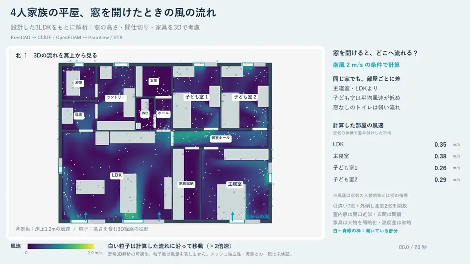

<div align="center">
  
  <h1>FreeCAD CFD Lab</h1>
  <p>From an editable house model to OpenFOAM airflow and animated streamlines.</p>
  <p>FreeCAD · CfdOF · OpenFOAM · ParaView / VTK · FFmpeg</p>
  <p><a href="README.md">English</a> | <a href="README.ja.md">日本語</a></p>
</div>

An archive of four connected OSS CAD/CFD experiments conducted on Windows in
October–November 2026: a CfdOF integration demo, two window layouts, a furnished
family-house design, and 3D airflow through that house. Includes editable models,
source scripts, inputs, measured result summaries, and visualization evidence.



## 🧪 Experiments

| Experiment | Question | Saved result |
| --- | --- | --- |
| [Elbow](experiments/elbow) | Can the OSS toolchain run the official CfdOF demo? | 10,823 cells; final iteration 242 |
| [Window comparison](experiments/window-comparison) | How do opposite and adjacent windows change indoor flow? | Two steady 2D cases; 12-second animation |
| [Family-house design](experiments/family-house) | Can an editable furnished 3LDK plan be built in FreeCAD? | BIM model, design JSON, drawings, 7-page design PDF |
| [Family-house airflow](experiments/family-house-airflow) | Where does wind travel with the house windows open? | 538,479-cell 3D case; final iteration 697; 20-second animation |

[Experiment guide and numerical results](docs/experiments.md)

## 👀 Explore without installing CFD tools

1. Browse the animation above, each experiment's images and saved JSON evidence.
2. Download the `.FCStd` files to inspect or edit the FreeCAD models.
3. Get full final solver fields from the
   [data release](https://github.com/Sunwood-ai-labs/freecad-cfd-lab/releases/tag/experiment-data-v1).
   Archives unpack into `experiments/` from the repository root; large mesh and
   field data are intentionally kept outside Git.

```powershell
git clone https://github.com/Sunwood-ai-labs/freecad-cfd-lab.git
Set-Location freecad-cfd-lab
gh release download experiment-data-v1 --repo Sunwood-ai-labs/freecad-cfd-lab --pattern '*.zip' --pattern 'SHA256SUMS.txt' --dir downloads
```

Check the archive hashes against `downloads/SHA256SUMS.txt`, then extract only the
experiment you need. See [reproduction](docs/reproduction.md) for exact steps.

## 🌬️ Main findings

For the 3D house, a uniform south wind of 2 m/s, nine open windows, open interior
doorways and a closed entrance produced these volume-weighted mean speeds:

| Room | Mean speed |
| --- | --- |
| Living / dining / kitchen | 0.353 m/s |
| Main bedroom | 0.384 m/s |
| Child bedroom 1 | 0.262 m/s |
| Child bedroom 2 | 0.290 m/s |
| Toilet | 0.037 m/s |

Saved validation records show mesh quality acceptance, 69/69 geometry probes,
finite fields, flow balance checks and iteration stability. Main-room mean speeds
changed by at most 0.184% between iterations 585 and 697. The displayed particles
follow the final steady velocity field; the animation is not a transient solve
of opening the windows.

## 🔁 Reproduction and verification

- [Environment and recorded versions](docs/environment.md)
- [Download data, view results, render again, and recalculate](docs/reproduction.md)
- [Evidence, assumptions and limitations](docs/experiments.md)
- [Publication QA inventory](docs/qa-inventory.md)

The original experiment was run and its saved results checked. Adapted public
scripts, a clean runtime rebuild, and a complete rerun on another computer have
**not** been validated end to end. The final result includes manual numerical
adjustments and continuation; running the initial builder alone does not promise
the recorded final iteration.

This is an exploratory fictional-house study. Mesh independence, measured-data
agreement, other wind directions, thermal effects and building compliance were
not established. Mean speed is not a ventilation-rate or comfort certification.

## 📁 Layout

```text
experiments/   models, sources, inputs, media and historical validation JSON
runtime/       pinned container recipe and checked dependency downloads
docs/          experiment guide, Windows reproduction and publication QA
scripts/       repository validation and packaging helpers
```

## 📜 License and provenance

Original project material is MIT-licensed; upstream-derived material retains its
license. The official Elbow demo and CfdOF compatibility patch are attributed
separately in [third-party notices](THIRD_PARTY_NOTICES.md).

Upstream projects: [FreeCAD](https://github.com/FreeCAD/FreeCAD),
[CfdOF](https://github.com/jaheyns/CfdOF),
[OpenFOAM](https://www.openfoam.com/), [ParaView](https://www.paraview.org/).
